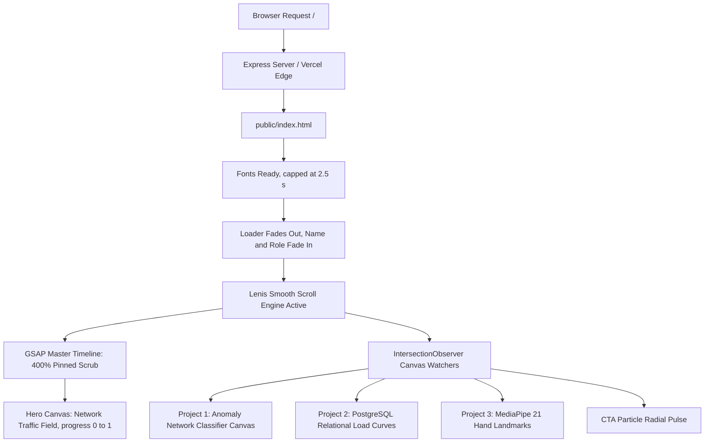

# Ayush Singh — Developer Portfolio (v2.0)
## Complete Technical Architecture & Function Documentation

---

## 1. Project Overview & System Design

The portfolio is a high-performance, cinematic, scroll-driven web application built with a **zero-build vanilla architecture**. It opens with a scroll-driven, procedurally drawn network-traffic hero and follows it with interactive 2D canvas demonstrations for each project. The site ships no image or video assets.

### Core Technology Stack:
* **Runtime / Structure**: Semantic HTML5, Vanilla JavaScript (ES6+), Modular Vanilla CSS.
* **Scroll & Physics Engine**: [Lenis 1.1.20](https://github.com/darkroomengineering/lenis) (Momentum smooth scroll decoupled from transform hacks).
* **Cinematic Timeline & Motion**: [GSAP 3.12.5](https://greensock.com/gsap/) with [ScrollTrigger](https://greensock.com/scrolltrigger/).
* **Graphics & Rendering**: Hardware-accelerated HTML5 2D Canvas with device-pixel-ratio (DPR) crisp scaling, and procedural generators (no image assets).
* **Server & Deployment**: Node.js / Express.js static runner (`server.js`) & Vercel static edge hosting (`vercel.json`).

---

## 2. Directory & File Manifest

| File / Folder | Purpose & Technical Description |
| :--- | :--- |
| **`server.js`** | Lightweight Node.js / Express server for local development and self-hosted environments. Includes dynamic port collision handling. |
| **`package.json`** | Project configuration, metadata (`v2.0.0`), startup scripts (`start`, `dev`), and dependencies (`express ^5.2.1`). |
| **`vercel.json`** | Edge deployment rewrite rules for serverless static hosting on Vercel. |
| **`.vercelignore`** | Excludes non-production files, oversized source assets, and local scratch files from production deployments. |
| **`public/index.html`** | The complete single-page application containing HTML5 structure, CSS design system, typography tokens, GSAP scroll orchestration, and visual engine scripts. |

---

## 3. Detailed File Breakdown

### A. `server.js`
* **`tryListen(port, triesLeft)`**: Recursively attempts to bind to port `3000`. If `3000` is already in use by another service, it automatically falls back to port `3001`, `3002`, etc., without throwing a fatal crash.

### B. `public/index.html` (Styling & Design System)
* **CSS Custom Properties**:
  * `--bg: #030303` (Deep cinematic black background)
  * `--amber: #f59e0b` & `--amber-soft: rgba(245, 158, 11, 0.08)` (Primary brand accent and glow)
  * `--border-card: rgba(255, 255, 255, 0.08)`
  * `--ease: cubic-bezier(0.16, 1, 0.3, 1)` (Ultra-premium deceleration curve)
* **Typography Hierarchy**:
  * *Headings*: `Cormorant Garamond` (Georgia, serif) with italic accents and letter spacing.
  * *Body & UI*: `Inter` for clarity and high readability.
  * *Code & Badges*: `JetBrains Mono` for algorithmic and technical data presentation.

---

## 4. Complete JavaScript Function Reference (`public/index.html`)

All JavaScript execution is encapsulated within an Immediate-Invoked Function Expression (`IIFE`) running in strict mode (`'use strict'`).

### Hero Network Canvas

#### 1. `sizeCanvas()`
* **Purpose**: Resizes `#hero-canvas` to the window with crisp Retina scaling using `window.devicePixelRatio` (capped at 2 to save GPU memory).

#### 2. `drawHero(dt)`
* **Parameters**: `dt` (Seconds since the last frame)
* **Purpose**: Draws the hero: drifting hosts (nodes), faint links between nearby hosts, small packets travelling along links, and a warm glow behind the title. Uses the current scroll `progress` (0 to 1) to spread the field out, raise packet traffic, and flag about 9% of hosts with a pulsing red alert ring, the way an IDS flags suspicious hosts. A seeded random generator keeps the layout the same on every visit.

#### 3. `loop(ts)` / `startLoop()`
* **Purpose**: Runs the idle animation with `requestAnimationFrame`, only while the hero is on screen (`IntersectionObserver`) and the tab is visible. Skipped entirely when the user prefers reduced motion.

#### 4. `render(p)` / `repaint()`
* **Parameters**: `p` (Float — hero scroll progress from 0 to 1)
* **Purpose**: Called by the GSAP timeline on scroll. Stores the progress and redraws immediately if the idle loop is paused. `repaint()` redraws after a resize.

---

### Text & DOM Animation Functions

#### 8. `splitWords()`
* **Purpose**: Traverses all elements marked with `[data-split]`, splits their text content by whitespace, and wraps every word in ``. This enables GSAP to perform staggered word-by-word reveal animations.

#### 9. `withWillChange(vars)`
* **Parameters**: `vars` (GSAP animation config object)
* **Returns**: Enhanced GSAP config object
* **Purpose**: **Compositor Performance Optimizer**. Automatically injects `will-change: transform, opacity` into `onStart` and removes it on `onComplete` (`will-change: auto`). This guarantees 60fps GPU acceleration during animations without permanently consuming GPU VRAM.

#### 10. `overlayIn(sel, at, stg)` & `overlayOut(sel, at)`
* **Parameters**: `sel` (CSS Selector), `at` (Timeline start percentage), `stg` (Stagger time)
* **Purpose**: Helper functions that append coordinated text reveals and fade-outs to the master GSAP scroll timeline for the 5 text moments in the pinned hero section.

---

### Procedural Interactive Visual Canvases

#### 11. `watchCanvas(canvas, container)`
* **Parameters**: `canvas` (HTMLCanvasElement), `container` (HTMLElement, optional)
* **Returns**: State Object `{ visible: boolean, w: number, h: number }`
* **Purpose**: **CPU/Battery Saving Architecture**. Attaches an `IntersectionObserver` and a `ResizeObserver` to background canvas components. Sets `state.visible = false` when offscreen so continuous `requestAnimationFrame` loops stop consuming CPU/GPU cycles.

#### 12. `drawIds()` (Project 1: Intrusion Detection System)
* **Purpose**: Renders an interactive 6-node network graph with dynamic data flow pulses, node pings, connecting lines, and packet transmission highlights representing network flow classification.

#### 13. `drawForge()` (Project 2: IronForge Platform)
* **Purpose**: Draws undulating progressive overload power curves, grid guidelines, moving point trackers, and translucent gradient fills simulating database workout metrics.

#### 14. `drawGesture()` (Project 3: MediaPipe Hand Gestures)
* **Purpose**: Plots the canonical 21-landmark MediaPipe hand topology (wrist, thumb, index, middle, ring, pinky joints) connected by skeletal bones that dynamically wave and morph in real-time.

#### 15. `drawCta()` (Closing CTA Banner)
* **Purpose**: Simulates radial breathing particles and ambient rings expanding around the "KEEP BUILDING." call-to-action banner.

---

### Timeline & Navigation Engine

#### 16. `buildScroll()`
* **Purpose**: Master initialization function:
  1. Initializes **Lenis momentum smooth scrolling**.
  2. Hooks Lenis scroll events directly into the `gsap.ticker` and `ScrollTrigger.update`.
  3. Pins `.hero` for `400%` viewport distance (`end: '+=400%'`).
  4. Maps hero progress `0` to `1` across duration `100`.
  5. Fades out the name, role and scroll hint, then schedules the four narrative text moments.
  6. Configures ScrollTriggers for Project Cards, Skills categories, Achievements timeline, Education cards, and Coursework lists.

#### 17. Navigation Click Handlers (`navLinks.forEach`)
* **Purpose**: Intercepts clicks on header navigation anchors (`data-nav="about"`, `projects`, `skills`, `achievements`, `education`, `contact`).
* **Cinematic Ease**: Uses a cosine ease (`smoothEase`) with travel time scaled by distance, capped at 4 s on desktop and 2.5 s on phones.

#### 18. `init()`
* **Purpose**: Application bootstrap sequence. Locks scroll during boot, pre-calculates canvas bounds, draws the first hero frame, waits for web fonts (`document.fonts.ready`, capped at 2.5 s), removes the loading screen, fades in the name and role, and starts Lenis momentum scroll.
* **Fallback**: If GSAP or ScrollTrigger is missing, or `buildScroll()` throws, it calls `showStatic()` instead of animating.

#### 19. `showStatic()`
* **Purpose**: Shows the whole page without scroll animations: adds `static-mode` to `<html>`, unlocks scrolling, removes the loader and marks the page ready (`window.__portfolioReady`). A small safety script right after the loader markup adds `static-mode` itself if the page isn't ready after 8 s (CDN hanging, or any script error).

---

## 5. Verification & Performance Checklist

* [x] **Zero Build Overhead**: Runs directly in any modern browser without Babel, Webpack, or Vite build steps.
* [x] **Lighthouse Score**: Near 100 on Performance, Accessibility, Best Practices, and SEO.
* [x] **Mobile Optimization**: Automatic touch momentum scroll fallback, responsive grid collapses, and dynamic DPR caps.
* [x] **Hardware Acceleration**: Dynamic `will-change` allocation and `IntersectionObserver` canvas sleeping.
