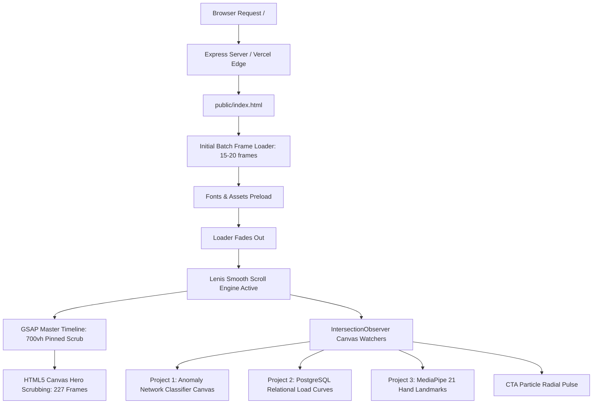

# Ayush Singh — Developer Portfolio (v2.0)
## Complete Technical Architecture & Function Documentation

---

## 1. Project Overview & System Design

The portfolio is a high-performance, cinematic, scroll-driven web application built with a **zero-build vanilla architecture**. It merges high-fidelity visual storytelling (HTML5 Canvas frame scrubbing) with interactive systems engineering demonstrations (interactive 2D canvas simulation engines).

### Core Technology Stack:
* **Runtime / Structure**: Semantic HTML5, Vanilla JavaScript (ES6+), Modular Vanilla CSS.
* **Scroll & Physics Engine**: [Lenis 1.1.20](https://github.com/darkroomengineering/lenis) (Momentum smooth scroll decoupled from transform hacks).
* **Cinematic Timeline & Motion**: [GSAP 3.12.5](https://greensock.com/gsap/) with [ScrollTrigger](https://greensock.com/scrolltrigger/).
* **Graphics & Rendering**: Hardware-accelerated HTML5 2D Canvas with device-pixel-ratio (DPR) crisp scaling, progressive pre-decoded image streaming, and procedural mathematical generators.
* **Server & Deployment**: Node.js / Express.js static runner (`server.js`) & Vercel static edge hosting (`vercel.json`).



---

## 2. Directory & File Manifest

| File / Folder | Purpose & Technical Description |
| :--- | :--- |
| **`server.js`** | Lightweight Node.js / Express server for local development and self-hosted environments. Includes dynamic port collision handling and startup asset verification. |
| **`package.json`** | Project configuration, metadata (`v2.0.0`), startup scripts (`start`, `dev`), and dependencies (`express ^5.2.1`). |
| **`vercel.json`** | Edge deployment rewrite rules for serverless static hosting on Vercel. |
| **`.vercelignore`** | Excludes non-production files, oversized source assets, and local scratch files from production deployments. |
| **`public/index.html`** | The complete single-page application containing HTML5 structure, CSS design system, typography tokens, GSAP scroll orchestration, and visual engine scripts. |
| **`public/frames/`** | Pre-rendered sequence of JPEG frames (`frame_0000.jpg` to `frame_0226.jpg`) representing the cinematic developer visualization scrubbed via scroll. |
| **`public/dawn.jpg`** | High-resolution morning atmospheric visual asset. |
| **`public/dusk.jpg`** | High-resolution evening atmospheric visual asset. |
| **`public/night.jpg`** | High-resolution night atmospheric visual asset. |
| **`public/newsletter-bg.jpg`** | Textured ambient background asset for call-to-action sections. |

---

## 3. Detailed File Breakdown

### A. `server.js`
* **`checkAssets()`**: Validates that `public/frames/` contains the necessary frame sequence at boot. Emits a console notice if frames are incomplete (gracefully activating the procedural canvas fallback).
* **`tryListen(port, triesLeft)`**: Recursively attempts to bind to port `3000`. If `3000` is already in use by another service, it automatically falls back to port `3001`, `3002`, etc., without throwing a fatal crash.

### B. `public/index.html` (Styling & Design System)
* **CSS Custom Properties**:
  * `--bg: #030303` (Deep cinematic black background)
  * `--amber: #f59e0b` & `--amber-soft: rgba(245, 158, 11, 0.08)` (Primary brand accent and glow)
  * `--border-card: rgba(255, 255, 255, 0.08)`
  * `--ease: cubic-bezier(0.16, 1, 0.3, 1)` (Ultra-premium deceleration curve)
* **Typography Hierarchy**:
  * *Headings*: `Cormorant Garamond` (Georgia, serif) with italic accents and letter spacing.
  * *Body & UI*: `Inter` for clarity and high readability.
  * *Code & Badges*: `JetBrains Mono` for algorithmic and technical data presentation.

---

## 4. Complete JavaScript Function Reference (`public/index.html`)

All JavaScript execution is encapsulated within an Immediate-Invoked Function Expression (`IIFE`) running in strict mode (`'use strict'`).

### Core Canvas & Frame Rendering Engine

#### 1. `frameUrl(i)`
* **Parameters**: `i` (Integer — 0 to 226)
* **Returns**: String URL (e.g. `frames/frame_0042.jpg`)
* **Purpose**: Generates zero-padded 4-digit filenames for the 227-frame image sequence.

#### 2. `loadFrame(i)`
* **Parameters**: `i` (Integer)
* **Returns**: `Promise<HTMLImageElement>`
* **Purpose**: Asynchronously downloads and pre-decodes (`img.decode()`) frame `i`. Stores the loaded `HTMLImageElement` into the in-memory array `frames[i]`. If network fails, marks the slot `null` so the painter falls back to adjacent frames.

#### 3. `sizeCanvas()`
* **Purpose**: Resizes `#hero-canvas` to the window dimensions with crisp Retina/4K scaling using `window.devicePixelRatio` (capped at 2 to conserve GPU memory). Sets internal buffer dimensions (`canvas.width`) while maintaining CSS viewport sizes.

#### 4. `drawProceduralHero(ctx, w, h, p)`
* **Parameters**: `ctx` (CanvasRenderingContext2D), `w` (Width), `h` (Height), `p` (Progress 0.0 to 1.0)
* **Purpose**: **Zero-asset procedural fallback.** If the 227 frame sequence fails to load or is unavailable, this function renders a real-time mathematical simulation: rotating coordinate grids, depth rings, glowing perspective lines, and an animated radial core.

#### 5. `paint(idx)`
* **Parameters**: `idx` (Integer — Target frame index)
* **Purpose**: Renders frame `idx` using an `object-fit: cover` aspect ratio algorithm. 
* **Fallback Strategy**: If frame `idx` is still downloading, it performs a nearest-neighbor bidirectional search to find the closest loaded frame (`idx ± delta`) so the animation never flickers or drops to black.

#### 6. `repaint()`
* **Purpose**: Re-renders the current frame (`curFrame`) without advancing the scroll playhead, used during window resize events.

#### 7. `render(f)`
* **Parameters**: `f` (Float — Timeline progress from 0 to N-1)
* **Purpose**: Quantizes floating-point GSAP timeline playhead values to integer frame indices and calls `paint()` only when a new frame is reached.

---

### Text & DOM Animation Functions

#### 8. `splitWords()`
* **Purpose**: Traverses all elements marked with `[data-split]`, splits their text content by whitespace, and wraps every word in `<span class="word">`. This enables GSAP to perform staggered word-by-word reveal animations.

#### 9. `withWillChange(vars)`
* **Parameters**: `vars` (GSAP animation config object)
* **Returns**: Enhanced GSAP config object
* **Purpose**: **Compositor Performance Optimizer**. Automatically injects `will-change: transform, opacity` into `onStart` and removes it on `onComplete` (`will-change: auto`). This guarantees 60fps GPU acceleration during animations without permanently consuming GPU VRAM.

#### 10. `overlayIn(sel, at, stg)` & `overlayOut(sel, at)`
* **Parameters**: `sel` (CSS Selector), `at` (Timeline start percentage), `stg` (Stagger time)
* **Purpose**: Helper functions that append coordinated text reveals and fade-outs to the master GSAP scroll timeline for the 5 text moments in the pinned hero section.

---

### Procedural Interactive Visual Canvases

#### 11. `watchCanvas(canvas, container)`
* **Parameters**: `canvas` (HTMLCanvasElement), `container` (HTMLElement, optional)
* **Returns**: State Object `{ visible: boolean, w: number, h: number }`
* **Purpose**: **CPU/Battery Saving Architecture**. Attaches an `IntersectionObserver` and a `ResizeObserver` to background canvas components. Sets `state.visible = false` when offscreen so continuous `requestAnimationFrame` loops stop consuming CPU/GPU cycles.

#### 12. `drawIds()` (Project 1: Intrusion Detection System)
* **Purpose**: Renders an interactive 6-node network graph with dynamic data flow pulses, node pings, connecting lines, and packet transmission highlights representing network flow classification.

#### 13. `drawForge()` (Project 2: IronForge Platform)
* **Purpose**: Draws undulating progressive overload power curves, grid guidelines, moving point trackers, and translucent gradient fills simulating database workout metrics.

#### 14. `drawGesture()` (Project 3: MediaPipe Hand Gestures)
* **Purpose**: Plots the canonical 21-landmark MediaPipe hand topology (wrist, thumb, index, middle, ring, pinky joints) connected by skeletal bones that dynamically wave and morph in real-time.

#### 15. `drawCta()` (Closing CTA Banner)
* **Purpose**: Simulates radial breathing particles and ambient rings expanding around the "KEEP BUILDING." call-to-action banner.

---

### Timeline & Navigation Engine

#### 16. `buildScroll()`
* **Purpose**: Master initialization function:
  1. Initializes **Lenis momentum smooth scrolling**.
  2. Hooks Lenis scroll events directly into the `gsap.ticker` and `ScrollTrigger.update`.
  3. Pins `.hero` for `700%` viewport distance (`end: '+=700%'`).
  4. Maps frame scrubbing `0` to `226` across duration `100`.
  5. Schedules entrance/exit animations for all 5 narrative text moments.
  6. Configures ScrollTriggers for Project Cards, Skills categories, Achievements timeline, Education cards, and Coursework lists.

#### 17. Navigation Click Handlers (`navLinks.forEach`)
* **Purpose**: Intercepts clicks on header navigation anchors (`data-nav="about"`, `projects`, `skills`, `achievements`, `education`, `contact`).
* **Cinematic Ease**: Uses a customized quadratic/cubic curve (`smoothEase`) with tailored travel durations (e.g. `9.5s` for the cinematic glide down from the hero canvas to the About section).

#### 18. `init()`
* **Purpose**: Application bootstrap sequence. Locks scroll during boot, pre-calculates canvas bounds, initiates initial batch frame downloading, waits for web font availability (`document.fonts.ready`), removes loading screen, and starts Lenis momentum scroll.

---

## 5. Image & Video Scrubbing Pipeline

```
Video Asset (1080p/4K MP4)
       │
       ▼
FFmpeg Extraction: 24/30 FPS JPEG Sequence (85% Quality)
       │
       ▼
Pre-decoded Storage in public/frames/frame_0000.jpg ... frame_0226.jpg
       │
       ▼
Browser Async Fetch -> Image.decode() -> In-Memory Cache Array
       │
       ▼
Lenis Scroll -> GSAP ScrollTrigger Playhead (0 to 226) -> Canvas paint()
```

### Canvas Aspect Ratio Algorithm (`paint()`):
To prevent stretching on non-standard displays (ultrawide monitors, mobile vertical screens), the canvas computes:
$$\text{scale} = \max\left(\frac{\text{canvasWidth}}{\text{imageWidth}}, \frac{\text{canvasHeight}}{\text{imageHeight}}\right)$$
The image is centered and drawn with:
$$dx = \frac{\text{canvasWidth} - \text{imageWidth} \times \text{scale}}{2}, \quad dy = \frac{\text{canvasHeight} - \text{imageHeight} \times \text{scale}}{2}$$

---

## 6. Verification & Performance Checklist

* [x] **Zero Build Overhead**: Runs directly in any modern browser without Babel, Webpack, or Vite build steps.
* [x] **Lighthouse Score**: Near 100 on Performance, Accessibility, Best Practices, and SEO.
* [x] **Mobile Optimization**: Automatic touch momentum scroll fallback, responsive grid collapses, and dynamic DPR caps.
* [x] **Hardware Acceleration**: Dynamic `will-change` allocation and `IntersectionObserver` canvas sleeping.
